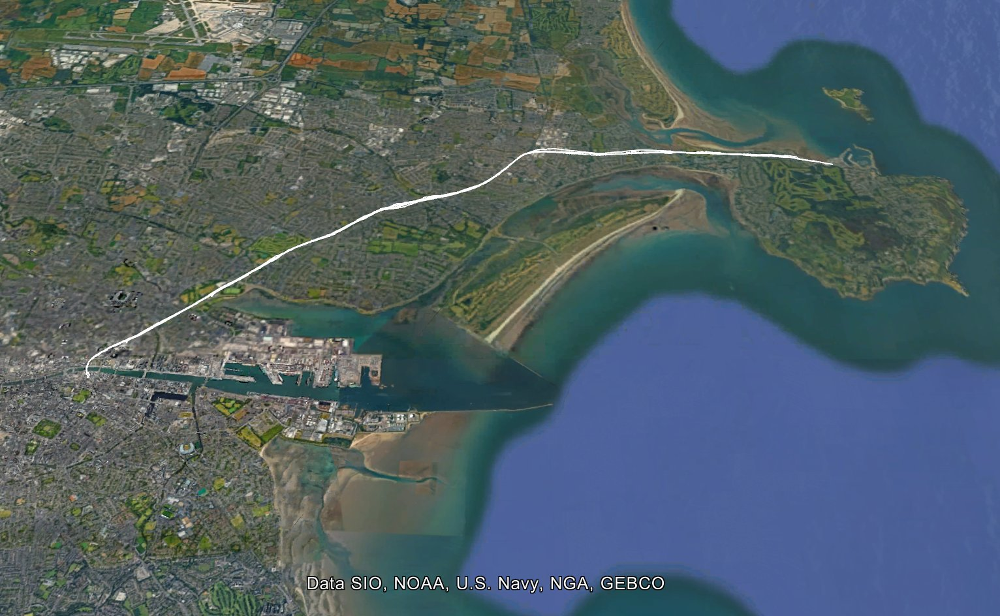
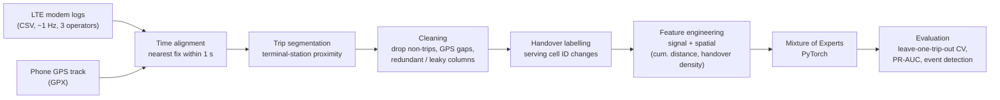
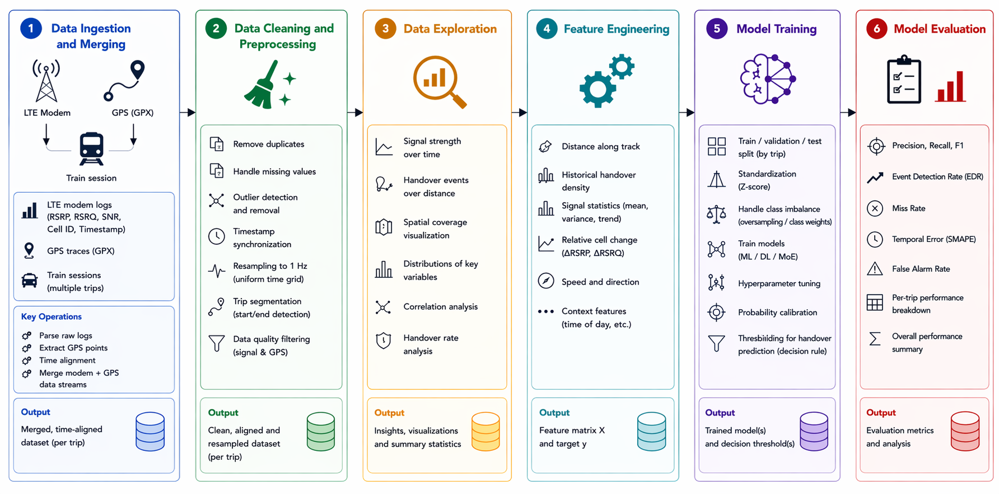
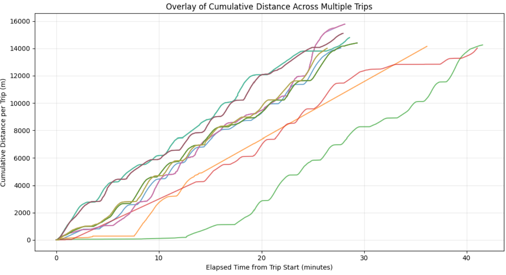
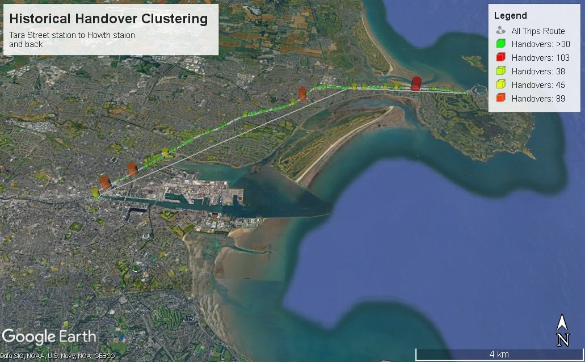
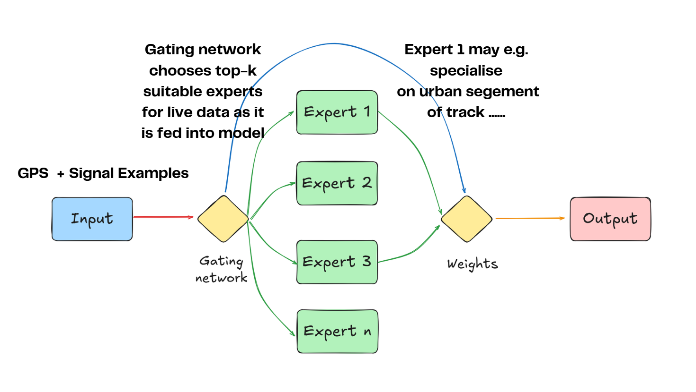
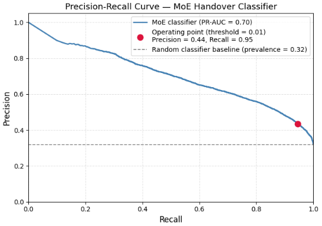
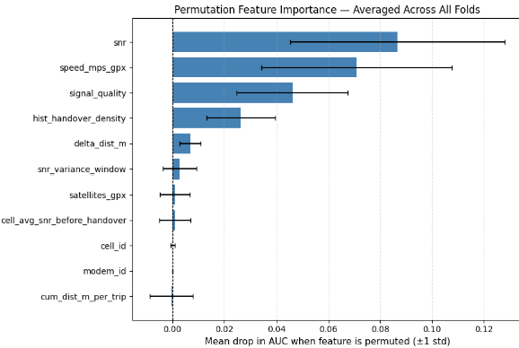

# Cellular Handover Prediction on Trains

**An end-to-end ML pipeline that predicts LTE handover events on a moving train, using real phone/modem network logs merged with GPS, collected on Dublin's DART line.**

-success)

Final Year Project, BSc Computer Science, University College Cork (2026). Supervised by Prof. Holger Claussen and Dr. Kariem Fahmi. Awarded a **First Class (1.1)** grade.

> **Showcase repository.** This repo holds a write-up, figures and a few short code excerpts. The full source code is kept private. See [Source code](#source-code) below.

---

## At a glance

| | |
|---|---|
| **Problem** | Predict when a train passenger's cellular connection is about to hand over to a new cell, so traffic can be moved to a more stable link *before* the drop |
| **Data** | I collected it myself: 9 DART journeys (Tara Street ⇄ Howth), up to 3 LTE modems on different operators, plus a GPS track. About **35,000** samples, **19** trip-instances |
| **Model** | Mixture of Experts (5 experts + gating network) in PyTorch, with learned cell/modem embeddings |
| **Evaluation** | Leave-one-trip-instance-out cross-validation (19 folds) |
| **Headline result** | **99%** event detection rate, **94%** recall, **0.70** PR-AUC (random baseline 0.32) |

---

## Motivation

Passengers on trains expect working video calls, streaming and gaming, but a moving train keeps crossing from one cell to the next. Every **handover** risks packet loss and latency spikes. Onboard routers (Irish Rail uses Peplink multi-WAN bonding, for example) combine several cellular links, but they react *after* a link degrades.

Train routes are **highly repeatable**: the same track, past the same base stations, every day. This project tests whether that structure, combined with live signal measurements, makes handovers **predictable** a few seconds in advance. A reliable early warning would let a multi-link system re-route or briefly duplicate latency-sensitive traffic on a link that is about to hand over.

**Research question:** *Can handover events in a railway environment be predicted reliably using machine-learning models trained on signal, spatial and temporal data?*

---

## Data collection

- **Route:** DART line from Tara Street to Howth and back, about 14 km, running from the dense city centre out to sparser coastal and suburban coverage.
- **Network logs:** LTE modems logged about once per second (RSRP, RSRQ, SNR, signal quality, cell ID, tracking area code). Later sessions ran **three modems in parallel on three operators** (Vodafone, Three, Meteor). Each modem was treated as its own observation stream.
- **Location:** an Android phone GPS logger recorded the track independently (GPX). Station arrival and departure times were also written down by hand to validate segmentation.
- **Volume:** 9 valid journeys and 19 trip-instances (one trip on one modem), giving about 35,000 samples. About 4% of samples are handovers, so the classes are heavily imbalanced.

Route-level GPS overlay of the recorded line (report, Fig. 4). Raw traces and data are not published.

---

## Pipeline architecture

Full implementation pipeline, from raw inputs to final predictions (report, Fig. 11).

---

## Methods

### 1. Merging network logs with GPS
The two logging systems are independent, so each modem sample is matched to the **nearest GPS fix within 1 second** (`pandas.merge_asof`). Samples recorded outside the GPS window or during short GPS outages are dropped, because without a location they can't be used for training. The cleaning stage also handles CSV files with missing headers, corrupted bytes and unparsable timestamps from logging interruptions.

### 2. Trip segmentation and a shared spatial axis
Segmenting on speed and dwell-time thresholds proved fragile with noisy GPS. The final method marks a trip boundary when the train has stayed **within 100 m of a terminal station** for a few seconds. Segments that are too short or have implausible durations (walking between platforms, waiting) are removed.

Every journey is then projected onto **cumulative distance along the route** (haversine/geodesic), which **resets at the start of each trip**. Trips of different speeds and dwell times then line up on one axis:

Cumulative distance per trip (report, Fig. 5).

### 3. Handover detection and clustering of handover locations
A handover is labelled whenever the **serving cell ID changes**, tracked separately for each modem. Clustering handover locations from all trips (**DBSCAN with a haversine metric**) and plotting them in Google Earth shows that handovers **happen in the same places journey after journey**. The densest clusters match the denser base-station deployment around the city centre.

Handover density along the line, Tara Street to Howth and back (report, Fig. 7).

### 4. Feature engineering
| Feature | Domain | Idea |
|---|---|---|
| `snr`, `signal_quality` (RSRQ) | Signal | Instantaneous link quality. Other strongly correlated signal metrics were dropped |
| `snr_variance_window` | Signal (engineered) | Rolling SNR variance over the last few samples. Unstable signal suggests competing cells |
| `cell_avg_snr_before_handover` | Signal (engineered) | Typical SNR at which each cell has historically handed over |
| `cum_dist_m_per_trip`, `delta_dist_m`, `speed_mps_gpx` | Spatial | Position and movement along the route |
| `hist_handover_density` | Spatial (engineered) | Historical handover rate in each **200 m** bin of track |
| `cell_id`, `modem_id` | Network | Learned **embeddings** (32-d), not one-hot |

A temporal feature domain was deliberately left out. Journeys vary in duration but not in distance, so the spatial features already capture where the train is along the route.

### 5. Problem formulation
Four formulations were tried in turn: time-to-handover regression, "handover in the next 1 s", "handover at the next sample", and finally **tolerance-window classification**. In the tolerance formulation, samples within a short window (*k* = 5 samples) around each upcoming handover are labelled positive, so the model is rewarded for flagging the conditions that lead into a handover rather than hitting its exact timestamp. This kept the operational value (an early warning) while making the target learnable.

### 6. The model: Mixture of Experts
The signal environment is not uniform: dense urban cells near Tara Street, sparse coastal coverage near Howth. A **Mixture of Experts** lets a gating network weight 5 expert MLPs (256 → 128 → 1) differently for each sample, so experts can specialise in different regimes.

- Inputs: standardised numeric features plus cell and modem embeddings
- Loss: `BCEWithLogitsLoss` with `pos_weight` (capped at 10) for class imbalance
- Adam (lr 1e-3) with `ReduceLROnPlateau`, up to 50 epochs, batch size 256
- **Leave-one-trip-instance-out CV** (19 folds). The scaler is fit on the training folds only, so the model is always tested on an unseen journey
- Decision threshold **t = 0.01**, chosen deliberately because a missed handover costs far more than a false alarm

Mixture of Experts architecture (report, Fig. 10; adapted from Bright Data's MoE overview).

---

## Results

All numbers below come from the dissertation (*Final Report*, Section 5) and the outputs of the final modelling notebook. None are estimates.

### Final model (tolerance-based MoE, *k* = 5, threshold 0.01)

| Metric | Value | Source |
|---|---|---|
| **Event detection rate** | **0.99** | Report Table 5 / Sec. 5.2.4 |
| **Recall** | **0.94** | Report Table 5 |
| **Precision** | **0.45** | Report Table 5 |
| **F1** | **0.60** | Report Table 5 |
| **PR-AUC** | **0.70** (0.7038) | Report Table 5; notebook output |
| Random-classifier PR baseline | 0.32 | Report Sec. 5.5 / Fig. 14 |

**Stability across the 19 CV folds** (report Table 7): recall 0.94 ± 0.03 (min 0.86), event detection 0.99 ± 0.02 (min 0.93), precision 0.44 ± 0.07, F1 0.60 ± 0.07.

### How the problem formulation changed the results (report Table 5)

| Formulation | Precision | Recall | F1 | PR-AUC | Note |
|---|---|---|---|---|---|
| Time-to-handover regression | – | – | – | – | SMAPE 75.4%, unstable near the handover |
| Binary, next 1 s | 0.88 | 0.99 | 0.91 | – | Inflated: about 70% positives, a dummy classifier already reaches 0.7 recall |
| Binary, next sample | 0.12 | 0.44 | 0.19 | 0.11 | Too strict to learn from this dataset |
| **Binary with tolerance (k = 5)** | **0.45** | **0.94** | **0.60** | **0.70** | **Selected** |

Tolerance window size (report Table 6): k = 2 gives PR-AUC 0.50, k = 3 gives 0.57, and k = 5 gives 0.70.

### What drives the predictions
Permutation importance averaged across folds (drop in PR-AUC, notebook output / report Fig. 16): **SNR 0.087**, **GPS speed 0.071**, **signal quality 0.046**, **historical handover density 0.026**. Cell ID, modem ID and raw cumulative distance score close to zero, which suggests the model learns signal regimes rather than memorising specific cells.

The gating network uses all five experts without collapsing onto one. Mean expert usage is 0.18 / 0.17 / 0.19 / 0.22 / 0.24 (report Sec. 5.7).

### Key findings
- Handovers **cluster at stable locations** across repeated journeys, so route-aware context is useful.
- **Signal features matter most**, and spatial history adds a moderate, real gain.
- **Problem formulation mattered as much as the model.** Exact timing is noisy, but the *conditions leading up to* a handover can be learned.

---

## Selected code

These are short, cleaned-up excerpts from the private notebooks. They don't run on their own and are not the full pipeline.

| Snippet | What it shows |
|---|---|
| [`snippets/01_log_gps_alignment.py`](snippets/01_log_gps_alignment.py) | Aligning modem logs and GPS by nearest timestamp (1 s tolerance), plus geodesic track distance |
| [`snippets/02_trip_segmentation.py`](snippets/02_trip_segmentation.py) | Splitting trips by station proximity, resetting distance per trip, filtering out non-trips |
| [`snippets/03_handover_clustering_and_features.py`](snippets/03_handover_clustering_and_features.py) | Handover labelling, DBSCAN (haversine) clustering of handover locations, spatial and signal features |
| [`snippets/04_moe_model_and_evaluation.py`](snippets/04_moe_model_and_evaluation.py) | The PyTorch Mixture of Experts and the event-detection metric |

---

## Tech stack

**Python** · **pandas** · **NumPy** · **PyTorch** · **scikit-learn** (DBSCAN, StandardScaler, KFold, metrics) · **geopy** · **Matplotlib / Seaborn** · **Jupyter** · Google Earth Pro (KML visualisation) · OpenStreetMap (station reference points)

---

## What I learned

- **Data work dominates real-world ML.** Most of the effort went into collection, alignment, segmentation and cleaning, and improvements to preprocessing and feature engineering (for example, resetting cumulative distance for each trip) contributed as much as model refinements.
- **Frame the problem around how it will be used.** The next-1-second formulation had impressive-looking metrics but no real value. A tolerance-based target was both learnable and useful.
- **Evaluate honestly.** I used trip-level cross-validation to avoid leakage, PR-AUC rather than accuracy given the 96/4 imbalance, and an event-level metric that reflects what a network operator actually cares about.
- Combining **wireless networking, data engineering and deep learning** in a single project.

## Future work

- Collect data on more routes and operators to test generalisation
- Run the model live in a multi-link router to drive selective packet replication
- Add richer features such as network load and neighbour-cell measurements
- Improve precision so false alarms don't trigger unnecessary mitigation

---

## Source code

**The full source code is kept private. It is available on request; contact me via https://darragh7.github.io**

More of my work: [github.com/Darragh7](https://github.com/Darragh7)

The raw dataset and GPS traces are not published because they contain personal location data.

---

© 2026 Darragh O'Keeffe. All rights reserved, shown for portfolio purposes only. Figures are taken from my dissertation. Map imagery © Google Earth (Data SIO, NOAA, U.S. Navy, NGA, GEBCO).
